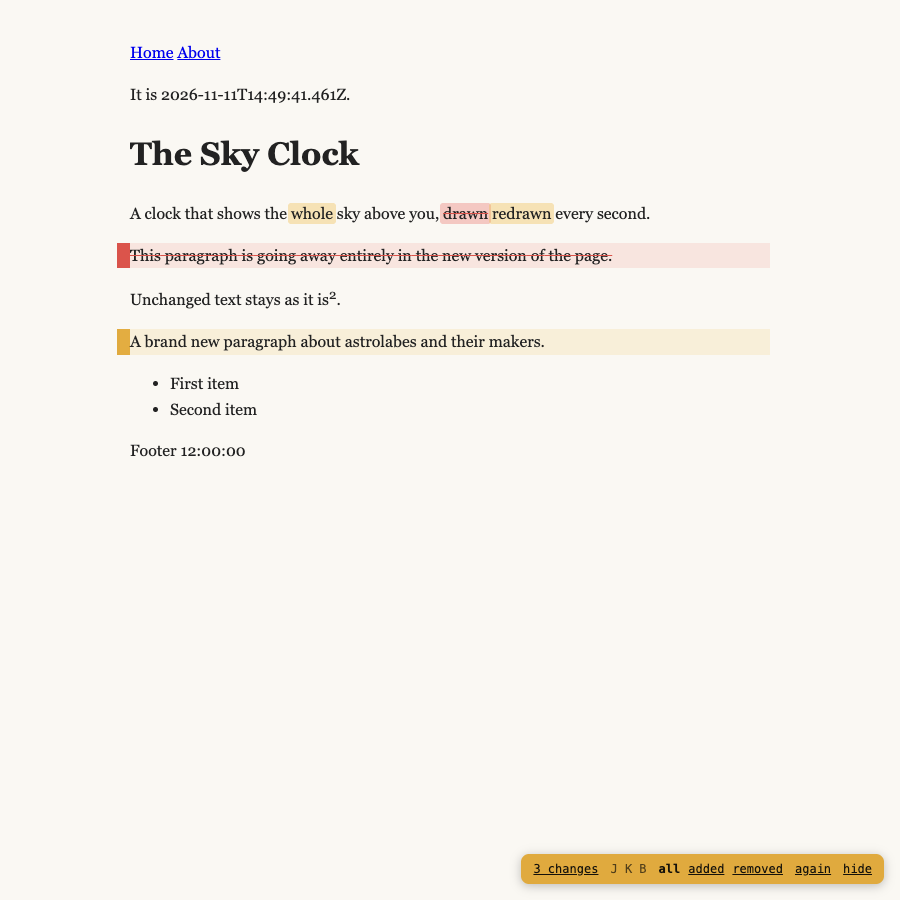
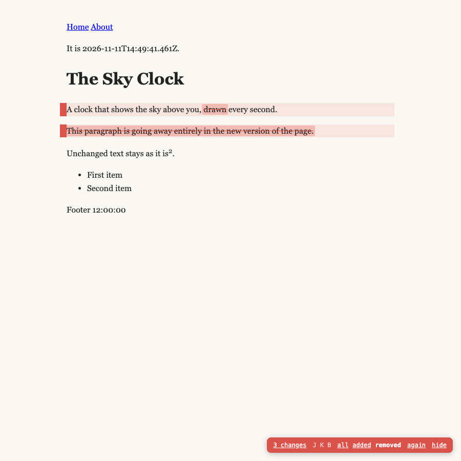
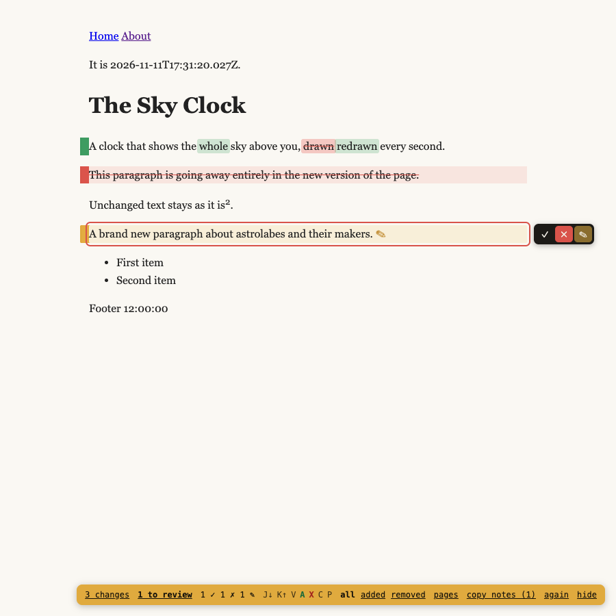
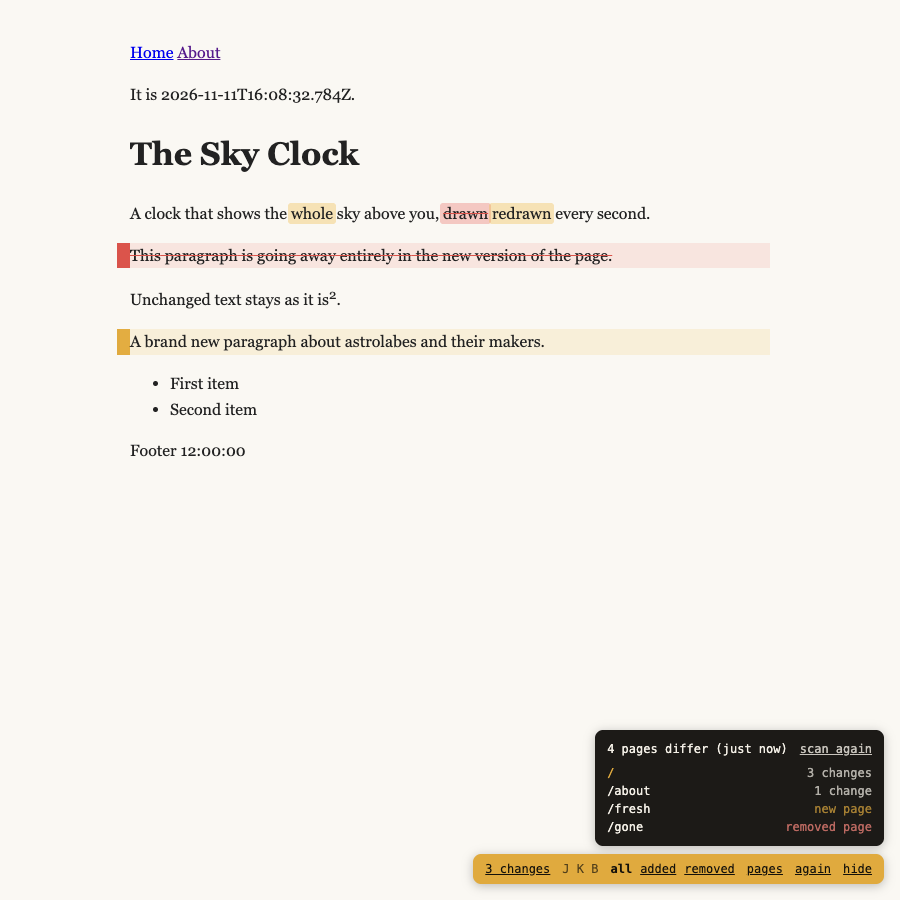
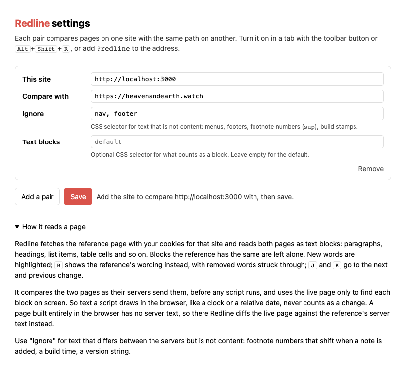

# Redline

A Chrome extension that shows, word by word, how the page you are on differs
from the same page on another site. Point it at your dev server and production
(or a second local server running `main`), and while you read the page you are
working on, new words are highlighted and removed words are struck through
right where they were.



Press <kbd>B</kbd> to switch between three views: **all** (the default, as
above), **added** (only what is new, with a removed paragraph shown as a
dashed line) and **removed** (the other site's wording, removed words struck
through). <kbd>J</kbd> and <kbd>K</kbd> go to the next and previous change.
The badge in the corner counts the changed blocks and switches views too.



## Review

Point at a change (or go to it with <kbd>J</kbd>/<kbd>K</kbd>) and a small
toolbar appears beside it: **✓** approves it (<kbd>A</kbd>), **✗** rejects it
(<kbd>X</kbd>), and **✎** (<kbd>C</kbd>) adds a note or suggested wording.
<kbd>A</kbd> and <kbd>X</kbd> move on to the next change still to review.
Approved changes turn green, rejected ones get a red ring, and the badge
counts them, with **N to review** for the changes nobody has reacted to yet;
click it to go to the next one.

**copy notes** puts every rejection, note and suggested wording on the
clipboard as a Markdown list, page by page, quoting the text and what it was
before: ready to paste to Claude, or into a pull request review.



Reviews are kept in this browser, per pair of sites. Each belongs to the exact
text of its change, so when a change is edited again, its review lapses and it
is up for review again. The pages list shows how far each page's review has
got.

## Pages

**pages** in the badge (or <kbd>P</kbd>) lists every page of the site that differs, with its
number of changes, and pages that are new or were removed. Click one to open
it with Redline on. It finds the pages from the site's `sitemap.xml` (and the
other site's, to catch removed pages), or, without one, by following links
from the page you are on.

It is made to be gentle on big sites. It runs only when you ask, fetches
three pages at a time, and checks 100 pages per click, starting with the ones
nearest the page you are on; **check 100 more** carries on, and **stop**
stops. It reads at most 5,000 addresses from the sitemaps (and 10 files of a
sitemap index) and follows at most 200 links. It always says how many pages
it has checked out of how many, so a partial list never passes for a full
one. The list stays for the tab until you scan again.



## Install

Not in the Chrome Web Store yet. To load it from this folder:

1. Clone the repo.
2. Open `chrome://extensions`, turn on **Developer mode**, click **Load
   unpacked** and pick the folder.
3. Pin Redline to the toolbar.

It should work the same in other Chromium browsers (Brave, Arc, Edge).

## Use

1. On a page of the site you are working on, click the Redline button (or
   press <kbd>Alt</kbd>+<kbd>Shift</kbd>+<kbd>R</kbd>). The first time, it
   opens the settings with this site filled in.
2. Fill in **Compare with**, for example `example.com` (https is assumed, or
   http for local addresses), and save.
   Chrome asks for access to both sites.
3. Click the button again, or add `?redline` to the address. Redline stays on
   in that tab as you navigate, including client-side navigation, until you
   click **hide** or the button.



Each pair has two optional fields:

- **Ignore**: a CSS selector for text that differs between the two sites but is
  not content, such as menus, footers, footnote numbers (`sup`) or a build
  stamp. Default for new pairs: `nav, footer`.
- **Text blocks**: a CSS selector for what counts as a block. The default is
  `p, h1–h6, li, dt, dd, blockquote, pre, td, th, caption, figure, summary`.

## Let your site set it up

A site can say what Redline should compare it with, so nobody has to fill in
the settings. Put this in the `<head>` of every page:

```html
<meta name="redline" content="https://example.com">
<!-- optional: text that differs but is not content -->
<meta name="redline-ignore" content="nav, footer, sup">
```

Clicking the Redline button on a page with the tag saves the pair and starts
comparing. Chrome asks once for access to both sites. If Chrome will not ask
straight from the click, the settings page opens with the pair filled in, and
one click on **Save** finishes it.

The tag wins over a saved pair. So when several projects take turns on
`localhost:3000`, each one with the tag is compared with its own reference.
A project without the tag uses whatever pair is saved for that address.

This is meant for preview builds, so `content` should be your production
address. It can stay on production too: there Redline compares the site with
itself and says nothing changed. Or render it only on previews, for example:

- **Vercel**: when `VERCEL_ENV` is `preview`.
- **Cloudflare Pages**: when `CF_PAGES_BRANCH` is not your production branch.
- **Cloudflare Workers Builds**: when `WORKERS_CI_BRANCH` is not your
  production branch.
- **Netlify**: when `CONTEXT` is `deploy-preview` or `branch-deploy`.

- **GitHub Pages**: Pages has no previews of its own, but the
  [pr-preview-action](https://github.com/rossjrw/pr-preview-action) publishes
  each pull request to a folder of the live site, by default
  `https://<user>.github.io/<repo>/pr-preview/pr-<number>/`. As that preview
  shares its address with the live site, also tell Redline which folder it is,
  so it compares `…/pr-preview/pr-5/about` with `…/about`:

  ```html
  <meta name="redline" content="https://<user>.github.io/<repo>">
  <meta name="redline-root" content="/<repo>/pr-preview/pr-5/">
  ```

  In the workflow, pass the folder to the build, for example as
  `REDLINE_ROOT: /${{ github.event.repository.name }}/pr-preview/pr-${{ github.event.number }}/`,
  and render the two tags only when it is set.

Vercel, Cloudflare and Netlify post their preview links on the pull request
themselves, so with the tag in place, a reviewer can open the link from the PR
and click Redline.

The same works by hand: in the settings, "this site" can be a folder, such as
`me.github.io/site/pr-preview/pr-5`.

In Next.js, for instance:

```tsx
// app/layout.tsx
export const metadata = {
  other: { redline: "https://example.com" },
};
```

## How it works

The reference page is fetched by the extension with your cookies for that
site, so a site behind a login works as long as you are signed in there. Both
pages are read as lists of text blocks, innermost first. Then:

1. Blocks are aligned by longest common subsequence.
2. Between two unchanged blocks, a new block that shares at least 40% of its
   words with an old one (Dice) is a rewrite of it, and gets a word-level diff.
   One that shares less is new.
3. Old blocks left over were removed.

It compares the text both servers send, before any script runs, and uses the
live page only to find each block on screen. So text drawn in the browser,
like a clock or "3 minutes ago", never shows up as a change. Pages built
entirely in the browser have no server text; for those, the live page is
diffed against the reference's server text, and **Ignore** is the way to keep
browser-drawn text out.

The highlights are made by wrapping words in `<mark>` and inserting the old
blocks next to the new ones. On pages run by a framework such as React this
edits the DOM under it, which is fine for prose but can confuse a page that
re-renders the same text. **again** in the badge compares afresh, for example
after a hot reload.

## Develop

```bash
npm install
npm test
```

`npm test` loads the extension into Playwright's Chromium against two small
local servers and checks what gets marked. `node test/live.mjs <this site>
<compare with> <path> [ignore]` tries it on real sites and saves screenshots
to `test/out/`.

## Origin

Generalised from the `?new` review mode of
[heavenandearth.watch](https://heavenandearth.watch), where the same diff runs
inside the site against its own `main`.

## License

MIT
