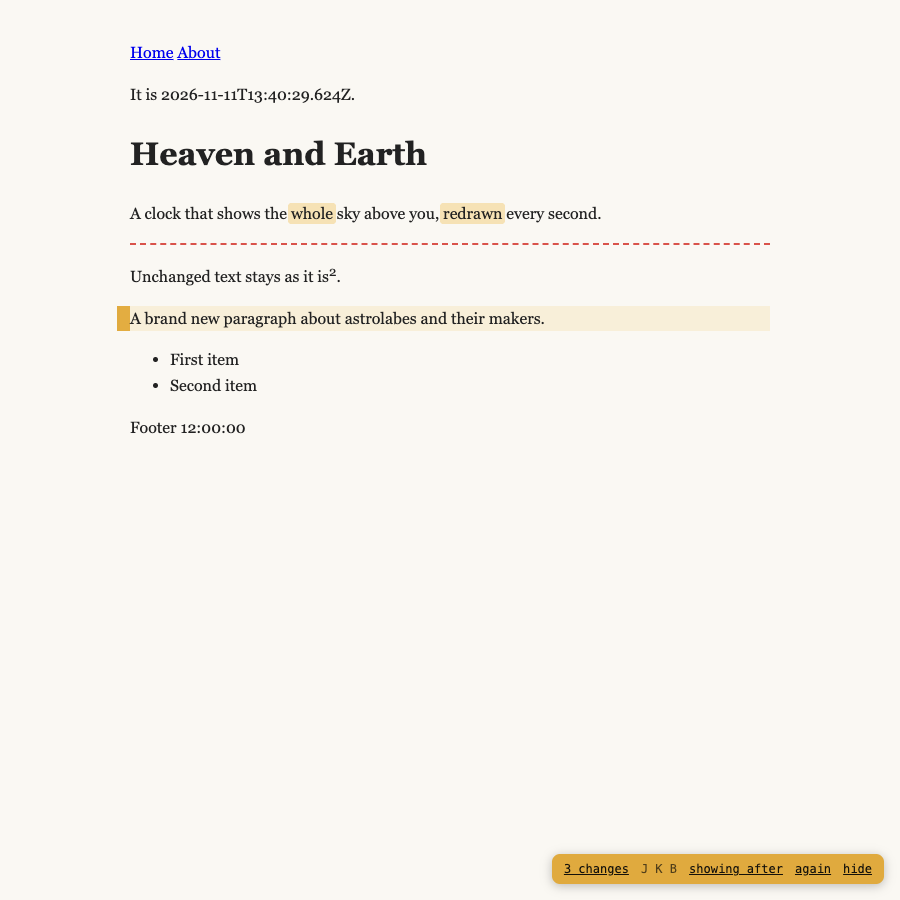
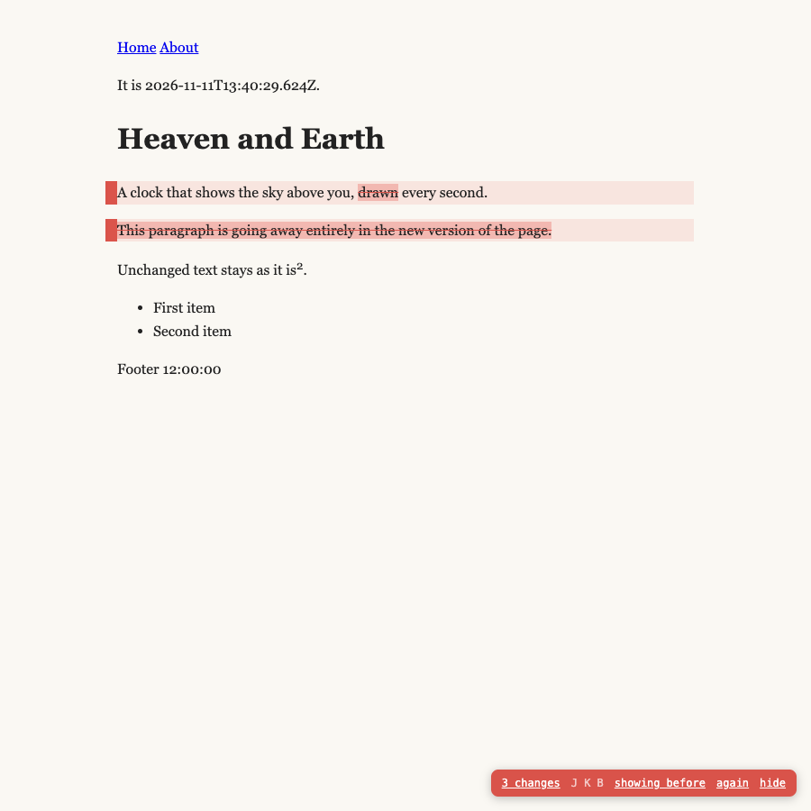

# Redline

A Chrome extension that shows, word by word, how the page you are on differs
from the same page on another site. Point it at your dev server and production
(or a second local server running `main`), and while you read the page you are
working on, every new word is highlighted and every removed paragraph is marked.



Press <kbd>B</kbd> to see the other site's wording instead, with the removed
words struck through. <kbd>J</kbd> and <kbd>K</kbd> go to the next and
previous change. The badge in the corner counts the changed blocks.



## Install

Not in the Chrome Web Store yet. To load it from this folder:

1. Clone the repo.
2. Open `chrome://extensions`, turn on **Developer mode**, click **Load
   unpacked** and pick the folder.
3. Pin Redline to the toolbar.

It should work the same in other Chromium browsers (Brave, Arc, Edge).

## Use

1. On a page of the site you are working on, click the Redline button (or
   press <kbd>Alt</kbd>+<kbd>Shift</kbd>+<kbd>R</kbd>). The first time, it
   opens the settings with this site filled in.
2. Fill in **Compare with**, for example `https://example.com`, and save.
   Chrome asks for access to both sites.
3. Click the button again, or add `?redline` to the address. Redline stays on
   in that tab as you navigate, including client-side navigation, until you
   click **hide** or the button.


Each pair has two optional fields:

- **Ignore**: a CSS selector for text that differs between the two sites but is
  not content, such as menus, footers, footnote numbers (`sup`) or a build
  stamp. Default for new pairs: `nav, footer`.
- **Text blocks**: a CSS selector for what counts as a block. The default is
  `p, h1–h6, li, dt, dd, blockquote, pre, td, th, caption, figure, summary`.

## How it works

The reference page is fetched by the extension with your cookies for that
site, so a site behind a login works as long as you are signed in there. Both
pages are read as lists of text blocks, innermost first. Then:

1. Blocks are aligned by longest common subsequence.
2. Between two unchanged blocks, a new block that shares at least 40% of its
   words with an old one (Dice) is a rewrite of it, and gets a word-level diff.
   One that shares less is new.
3. Old blocks left over were removed.

It compares the text both servers send, before any script runs, and uses the
live page only to find each block on screen. So text drawn in the browser,
like a clock or "3 minutes ago", never shows up as a change. Pages built
entirely in the browser have no server text; for those, the live page is
diffed against the reference's server text, and **Ignore** is the way to keep
browser-drawn text out.

The highlights are made by wrapping words in `<mark>` and inserting the old
blocks next to the new ones. On pages run by a framework such as React this
edits the DOM under it, which is fine for prose but can confuse a page that
re-renders the same text. **again** in the badge compares afresh, for example
after a hot reload.

## Develop

```bash
npm install
npm test
```

`npm test` loads the extension into Playwright's Chromium against two small
local servers and checks what gets marked. `node test/live.mjs <this site>
<compare with> <path> [ignore]` tries it on real sites and saves screenshots
to `test/out/`.

## Origin

Generalised from the `?new` review mode of
[heavenandearth.watch](https://heavenandearth.watch), where the same diff runs
inside the site against its own `main`.

## License

MIT
